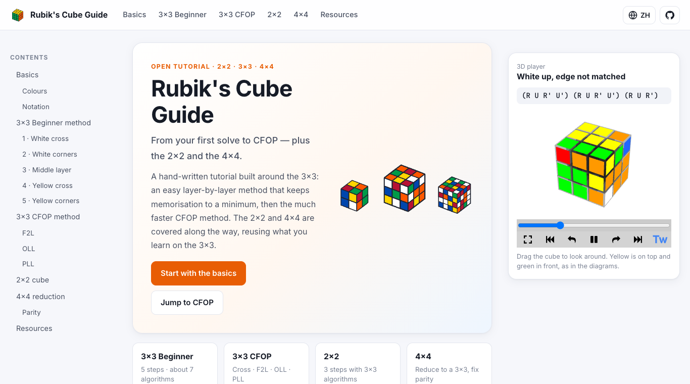

# Rubik's Cube Guide · 魔方教程

**🌐 Read it online: <https://ychenzgithub.github.io/RubiksCube/>**

A hand-written Rubik's Cube tutorial built around the 3×3: an easy layer-by-layer method that keeps memorisation to a minimum, then the faster CFOP method, with the 2×2 and the 4×4 along the way. The website is bilingual (English by default, 中文 with one click), every case diagram is generated from its algorithm, and every algorithm can be played on a 3D cube.

这是自己总结的中文魔方入门教程，介绍解魔方的初级方法。主要以三阶（3×3）魔方为主，也顺便介绍二阶魔方和四阶魔方。教程已整理成中英双语网页：每个情形的示意图都由公式自动生成，每个公式都可以在 3D 魔方上播放演示。

## Contents · 目录

| Topic | 主题 | Website |
| :--- | :--- | :--- |
| Basics: colours & notation | 基本知识 | [Basics](https://ychenzgithub.github.io/RubiksCube/#basics) |
| 3×3 beginner (layer-by-layer) method | 三阶魔方层先法 | [Beginner method](https://ychenzgithub.github.io/RubiksCube/#beginner) |
| 3×3 CFOP method (Cross, F2L, OLL, PLL) | 三阶魔方 CFOP 法 | [CFOP](https://ychenzgithub.github.io/RubiksCube/#cfop) |
| 2×2 cube | 二阶魔方 | [2×2](https://ychenzgithub.github.io/RubiksCube/#two) |
| 4×4 reduction method & parity | 四阶魔方降维法 | [4×4](https://ychenzgithub.github.io/RubiksCube/#four) |
| Useful links | 有用链接 | [Resources](https://ychenzgithub.github.io/RubiksCube/#links) |
| Full CFOP algorithm list | CFOP 公式列表 | [CFOP_list.pdf](./CFOP_list.pdf) |

## How the website works

- `index.html`, `assets/css/style.css` — the page (static, hosted on GitHub Pages).
- `assets/js/cube.js` — a small N×N×N cube simulator. Each diagram is drawn by applying the inverse of its algorithm to a solved cube, so a diagram always matches its algorithm.
- `assets/js/app.js` — language switching, diagram rendering, and the 3D player, which uses [cubing.js](https://js.cubing.net/cubing/) (`<twisty-player>`).
